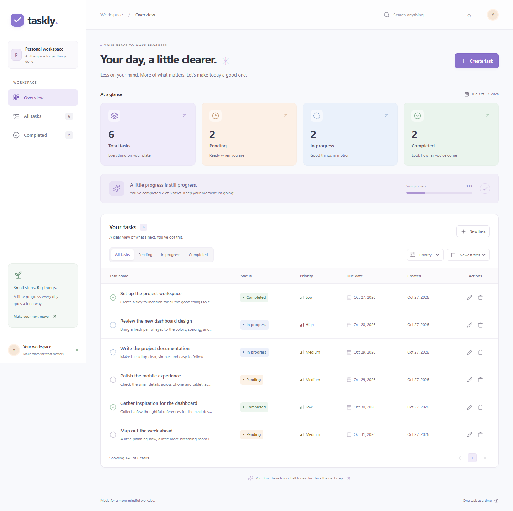
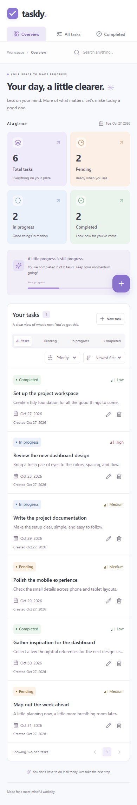

# Taskly

I made Taskly, a small task manager for a full-stack assignment. You can add tasks, open them, edit them, and delete them. The screen is built with React. The server is built with Python and FastAPI. Every change goes through the API. Tasks live only in the server’s memory.



## What I made

- A dashboard that shows how many tasks you have and how much is finished.
- Pages for the overview, all tasks, and completed tasks.
- A form to create and edit a task. Title and description are required. Due date is optional.
- Each task has an id, title, description, status, priority, due date, created time, and updated time.
- Status can only be pending, in progress, or completed. Priority can only be low, medium, or high.
- A details view, and a confirm step before a task is deleted.
- Search across titles and descriptions. The search waits 200 ms after you stop typing, then runs once.
- Filters for status and priority, sorting, and pages of six tasks.
- A table on a wide screen and cards on a phone.
- Loading, empty, success, and error messages, including a retry when the server cannot be reached.
- Dark mode. The choice is saved in the browser. If you have not chosen, it follows your system theme.
- A name prompt on the first visit. The name stays in the browser. Tasks do not.
- API docs at `/docs` (Swagger), plus automated backend tests and browser tests.

## Decisions I made

The assignment allowed more than one way to build this. These are the choices I made, and why.

**React with Vite for the frontend.** The assignment allowed React or Next.js. This app is a browser screen that talks to a separate API, so Vite was enough. I did not need a second server framework on the frontend.

**FastAPI for the backend.** The assignment allowed Express or FastAPI. I used Python and FastAPI because it checks request data for me and can publish Swagger docs from the same code.

**Tasks stay in memory.** The assignment said not to use a database. I keep tasks in a Python dictionary. A lock stops two requests from changing that dictionary at the same time. When the server restarts, the list is empty again. I run one server process, because each process would have its own dictionary.

**The same layers as the suggested backend, in Python.** The assignment showed a Node.js folder layout. I kept that idea and used Python files instead: routes, controllers, services, middleware, and the memory store. Routes only define the URLs. Controllers pass checked data to the service. The service creates ids and timestamps and owns the task rules. HTTP details stay out of the service.

**The server checks every request.** Pydantic checks the body before a task is saved. Title and description must be present, extra fields are rejected, and status and priority must be one of the allowed values. The form in the browser checks title and description first, so you see the problem before the request is sent. The server checks again so a bad request cannot skip the form.

**Status codes follow the assignment.** Creating a task returns 201. A successful read, update, or delete returns 200. A missing task returns 404. Bad input returns 400. FastAPI would normally use 422 for validation errors, so I changed that on purpose to match the assignment. Unexpected failures return 500 with a short message. The details are written to the server log.

**Errors are handled in one place.** Missing tasks, bad input, and unexpected crashes all go through the same error handlers. The frontend always gets JSON it can show.

**The frontend address is a setting.** Allowed browser addresses come from `CORS_ORIGINS` in a `.env` file. I can change the frontend address without editing the server code.

**API calls live in one file.** Components do not call the server themselves. `frontend/src/services/taskApi.js` does that. A hook, `useTasks`, holds the task list and updates the screen after create, update, and delete. The list is also refreshed from the server after a successful change.

**Search and filters run in the browser.** The server is only meant to hold a small list, so the app loads the tasks once and then searches, filters, sorts, and pages them on the screen. Waiting 200 ms avoids redoing that work on every keystroke.

**Swagger, not a separate Postman file.** The assignment asked for Postman or Swagger. FastAPI already serves Swagger at `/docs`, so that is the API documentation.

**No login, no database, and no pictures.** Those were outside the assignment. The name and the dark-mode choice are the only things stored in the browser.

## How the code is split

```text
backend/
  app/
    main.py                      starts the API, CORS, and error handlers
    api/routes/tasks.py          the five task URLs
    controllers/task_controller.py
    services/task_service.py
    schemas/task_schema.py       the shape of a task and of error responses
    middleware/error_handler.py
    storage/memory_store.py      the in-memory task list
    core/config.py               reads environment variables
  tests/test_tasks.py
  seed_demo.py                   optional sample tasks
frontend/
  src/
    services/taskApi.js          all API calls
    hooks/useTasks.js            task list and refresh after changes
    components/                  layout, dashboard, task screens, shared UI
    pages/Workspace.jsx
    App.jsx
  tests/tasks.spec.js            browser tests
docs/
  dashboard-desktop.png
  dashboard-mobile.png
```

## How to run it on Windows

You need Python 3.12 or newer, Node.js 22 LTS or newer, and npm. Browser tests use Microsoft Edge. Start from the project folder, `D:\CLEANOMATICS`.

Terminal 1, the server:

```bat
cd /d D:\CLEANOMATICS\backend
python -m venv .venv
.venv\Scripts\python -m pip install -r requirements.txt
copy .env.example .env
.venv\Scripts\python -m uvicorn app.main:app --reload --host 127.0.0.1 --port 8000
```

If that pip command fails and your system Python already has pip, use this instead:

```bat
python -m pip --python .venv\Scripts\python.exe install -r requirements.txt
```

Terminal 2, the website:

```bat
cd /d D:\CLEANOMATICS\frontend
npm ci
copy .env.example .env
npm run dev
```

Open http://127.0.0.1:5173. Open http://127.0.0.1:8000/docs for the API docs. Press Ctrl+C in a terminal to stop that server.

The task list starts empty. To add sample tasks, leave the server running and run:

```bat
cd /d D:\CLEANOMATICS\backend
.venv\Scripts\python seed_demo.py
```

The script only adds samples when the list is empty. It does not replace tasks you already created.

## Settings

Backend `.env`: `CORS_ORIGINS` is the list of website addresses allowed to call the API. The default is localhost and 127.0.0.1 on port 5173.

Frontend `.env`: leave `VITE_API_BASE_URL` blank while developing. Vite then forwards `/api` to port 8000. If the website and API are on different hosts, set the API address before building, and add the website address to `CORS_ORIGINS`. Vite settings are public, so do not put secrets in them. A production website also needs to send unknown page addresses to `index.html`, because the routes are handled by React.

## API

| Method | Endpoint | Success |
| --- | --- | --- |
| GET | `/api/tasks` | 200, all tasks, newest first |
| GET | `/api/tasks/{id}` | 200, one task |
| POST | `/api/tasks` | 201, the new task |
| PUT | `/api/tasks/{id}` | 200, the updated task |
| DELETE | `/api/tasks/{id}` | 200, `{ "message": "Task deleted", "id": "..." }` |

Example create body:

```json
{
  "title": "Review the dashboard",
  "description": "Check the layout and the task flow.",
  "status": "pending",
  "priority": "high",
  "dueDate": "2026-10-28"
}
```

`dueDate` can be left out or set to `null`. Title max length is 160 characters. Description max length is 5000. An update replaces the editable fields, so send the whole form. Send `null` to clear the due date. The server adds `id`, `createdAt`, and `updatedAt`. `createdAt` stays the same when you edit. A missing id returns 404. Bad input returns 400 with `message` and an `errors` list. A crash returns 500 with a short safe message.

## Tests

Backend tests, with no server running:

```bat
cd /d D:\CLEANOMATICS\backend
.venv\Scripts\python -m pytest -q
```

Frontend production build:

```bat
cd /d D:\CLEANOMATICS\frontend
npm run build
```

Browser tests. They start and stop their own servers:

```bat
cd /d D:\CLEANOMATICS\frontend
npm run test:e2e
```

Those tests use ports **18081** and **15174**, so they do not touch the app on ports 8000 and 5173. Leave the test ports free. On Windows they use Microsoft Edge. On another system, run `npx playwright install chromium` once.

Check formatting with `npm run format:check` from `frontend`. Apply it with `npm run format`.

To refresh the screenshots, seed an empty running server, then run `node scripts/screenshots.mjs` from `frontend`.

## Deliverables

These are the items the assignment asked me to hand in, and where each one is.

**GitHub repository with frontend and backend code.** Both apps are in this project. The website is in `frontend/`. The API is in `backend/`. The steps to put this on GitHub are in the GitHub section below.

**README with setup and run instructions.** This file. The steps are under "How to run it on Windows". Settings are under "Settings".

**API endpoint documentation.** The five endpoints, status codes, and an example body are under "API" in this file. The same contract is also in the running API docs.

**Swagger documentation.** I used Swagger instead of a Postman collection. With the server running, open http://127.0.0.1:8000/docs to try the endpoints. The raw schema is at http://127.0.0.1:8000/openapi.json.

**Environment examples.** Configurable values are listed in example files, with no secrets:

- `backend/.env.example` sets `CORS_ORIGINS`, the website addresses allowed to call the API.
- `frontend/.env.example` sets `VITE_API_BASE_URL`. Leave it blank in development so Vite forwards `/api` to port 8000.

Copy each file to `.env` before you start that app. The real `.env` files are not committed.

**Screenshots.** Desktop and phone views of the dashboard:



- Desktop: `docs/dashboard-desktop.png` (also shown at the top of this file)
- Phone: `docs/dashboard-mobile.png`

## Limits

- Tasks disappear when the backend restarts. A code reload restarts it too.
- There is no login, no database, and no live sync between browser tabs. Reload a second tab to see new data.
- Search, filters, sorting, and pages run on the list already loaded from the server. That fits a small in-memory list.
- This repository includes local setup. It is not deployed as a public website.

## GitHub

From the project folder, after you review the files. Use your own empty GitHub repository URL.

```bat
git init
git add .
git commit -m "Build Taskly full-stack task manager"
git branch -M main
git remote add origin https://github.com/YOUR_USERNAME/taskly.git
git push -u origin main
```

For the submission, include the repository URL, these setup steps, the test and build results, and the screenshots. Show creating a task, opening its details, editing its status, and confirming a delete. Mention that tasks are stored only in memory and reset on restart. `.env` files, virtual environments, installed packages, build output, logs, and test artifacts are ignored by git.
